# FoodApp

A mobile meal-planning app. It generates a weekly meal plan from your nutrient
targets and diet restrictions, tracks the nutrients you actually plan to eat,
lets you build a shopping cart from recipe ingredients and tracks your weight over time.

Built as my BSc engineering thesis project (Computer Science, Kielce University of Technology, 2025).

- **Backend:** Django 5 + Django REST Framework, JWT auth (SimpleJWT), PostgreSQL
- **Meal planning:** linear optimisation with [PuLP](https://coin-or.github.io/pulp/)
  (maximise/minimise a chosen nutrient under per-user min/max limits)
- **Frontend:** React Native (Expo SDK 52), React Navigation, NativeWind. Developed
  and tested with Expo Go on iOS; a web build is available for development.

## Features

- Registration and login (JWT access + rotating refresh tokens with blacklist)
- Recipe browsing by meal type, search by ingredients, recipe details with ingredients
- Sharing a recipe through the system share sheet
- Per-user nutrient preferences (min/max calories, protein, fat, carbs, fibre, ...)
- Diet types and disliked ingredients
- Automatic weekly meal plan, manual editing of plan items and quantities, replacing a recipe in the plan
- Daily/weekly nutrition summary with progress bars against your limits
- Shopping cart: add all ingredients of a recipe in one tap, edit quantities, tick off bought items
- Weight log (one entry per week) with a weight-history chart

## Screenshots

### Recipes

| Home | Search | Recipe details | Share |
|---|---|---|---|
| 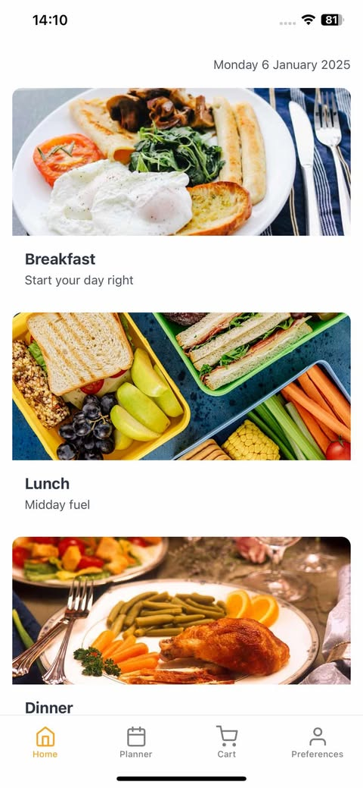 | 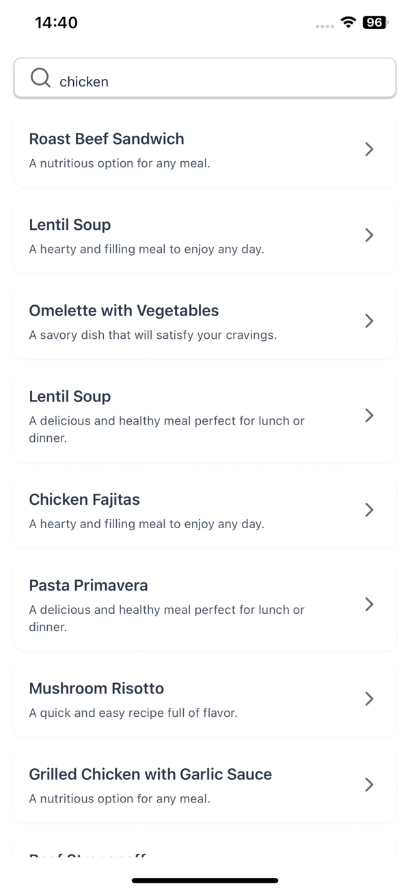 | 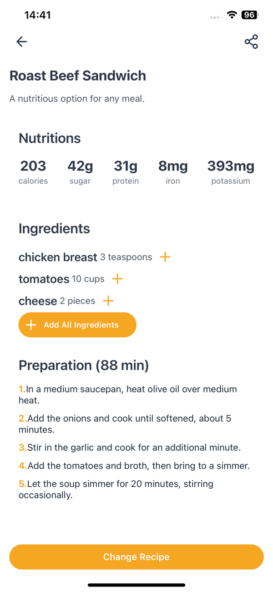 | 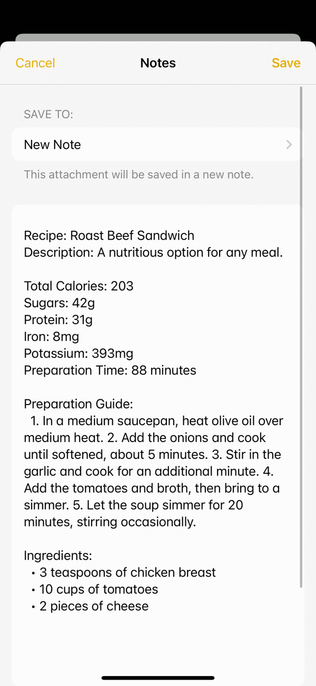 |

### Meal planner

| Weekly plan | Nutrient summary vs. limits | Daily items | Replace a recipe |
|---|---|---|---|
| 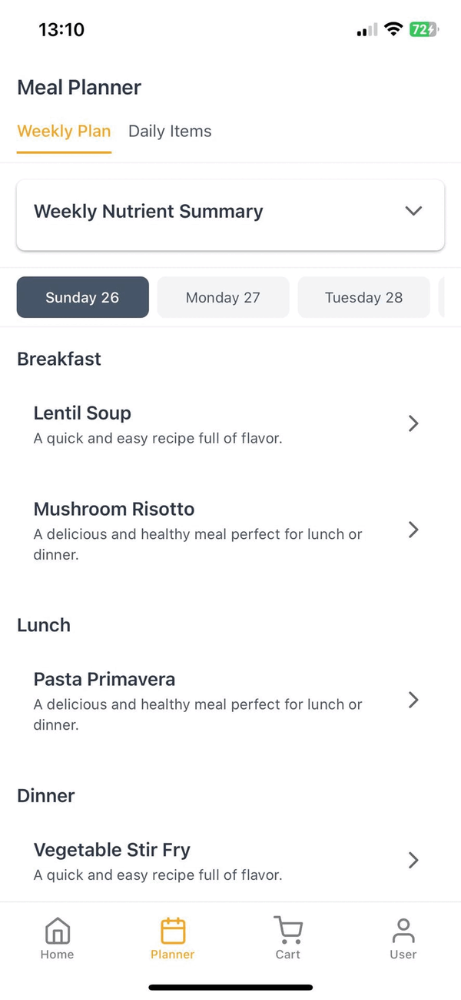 | 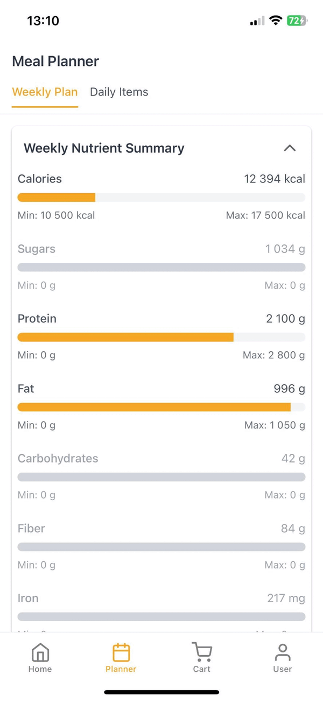 | 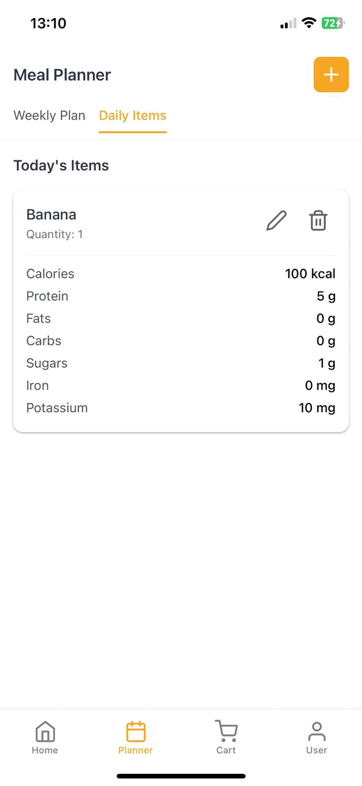 | 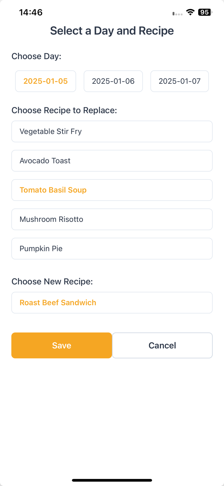 |

### Shopping cart

| Cart | Add ingredient |
|---|---|
| 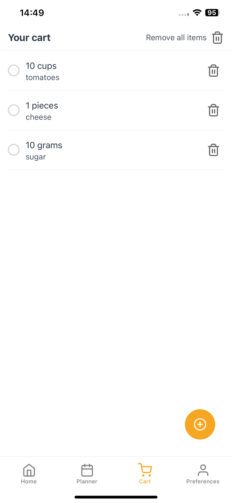 | 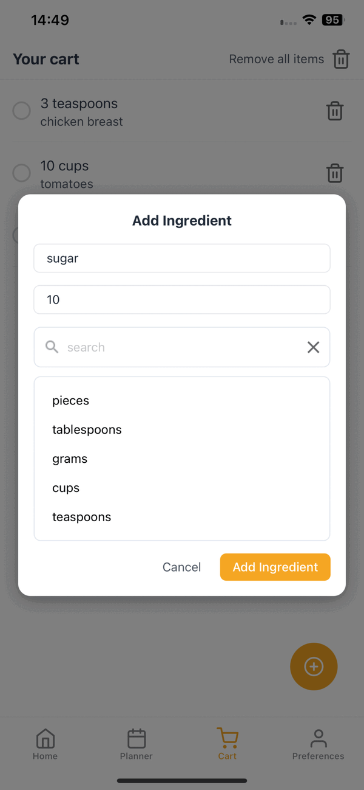 |

### Preferences

| Weight history | Weekly nutrition | Diet type | Nutrient limits | Blocked ingredients |
|---|---|---|---|---|
| 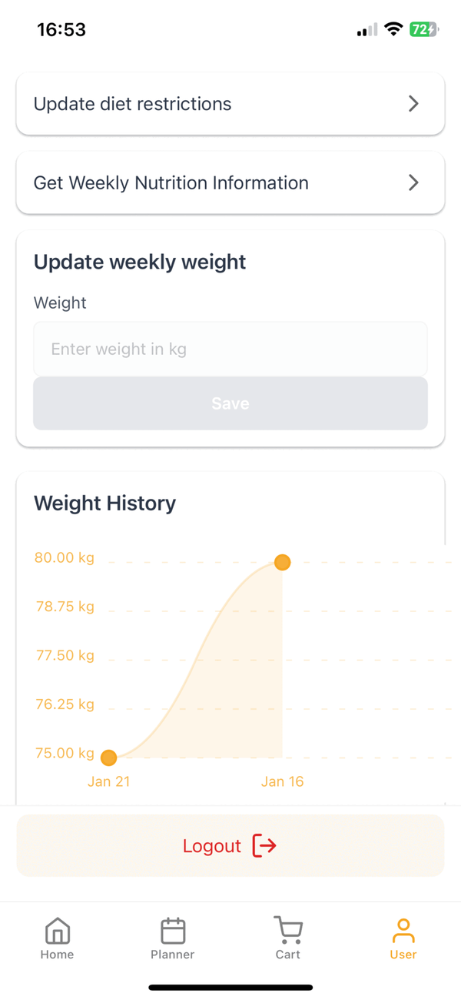 | 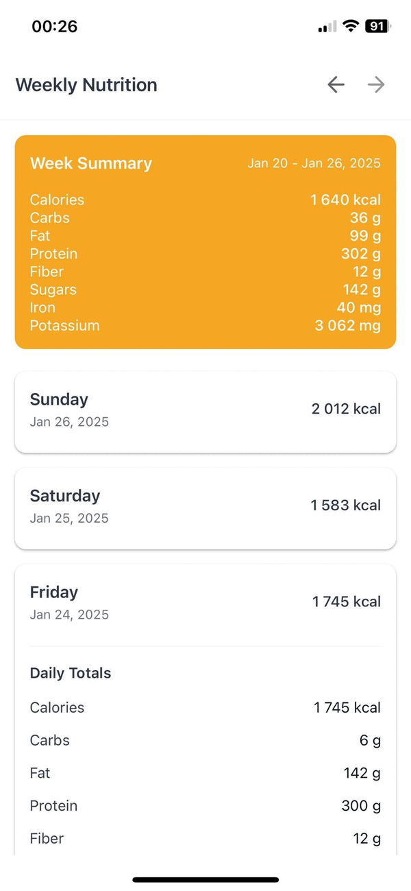 | 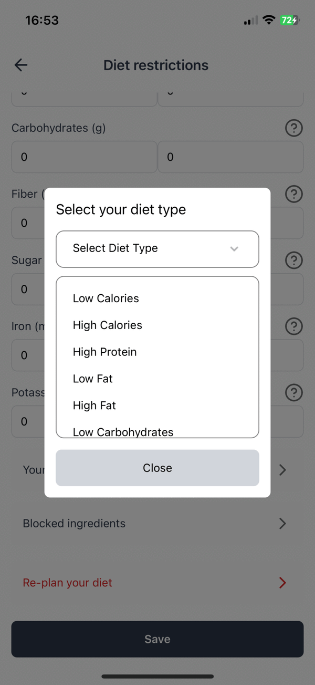 | 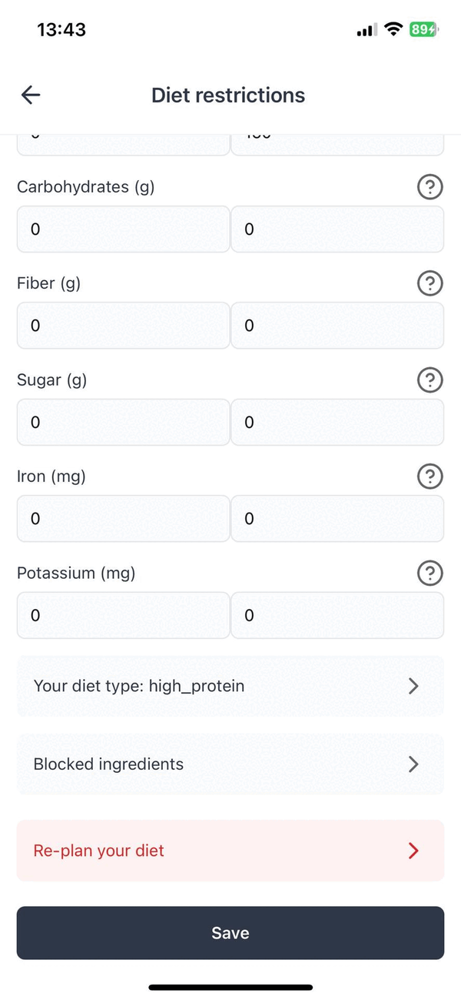 | 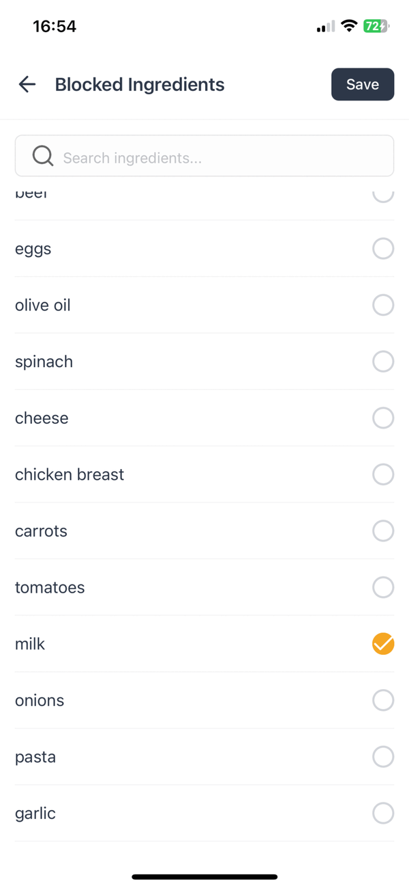 |

> The recipes in `backend/updated_data.csv` are generated sample data: titles,
> ingredients and preparation steps are not meant to be consistent with each other.

## How the meal planner works

The weekly plan is built day by day (`api/utils.py`). For each day the planner solves
a small integer linear program with PuLP (CBC solver):

- **Variables:** one binary variable per candidate recipe (selected / not selected).
  Candidates exclude recipes containing the user's disliked ingredients and recipes
  already used in the user's earlier plans.
- **Objective:** maximise or minimise one nutrient, chosen by the user's diet type
  (e.g. `high_protein` maximises protein, `low_calories` minimises calories).
- **Constraints:**
  - at most 6 meals per day,
  - at least one meal of each type (breakfast, lunch, dinner, snack),
  - for every nutrient with limits set, the daily total must stay between the
    user's minimum and maximum (calories, protein, fat, carbohydrates, fibre,
    sugars, iron, potassium).

The user can then edit the plan manually (add items, change quantities, replace a recipe).

## Data model

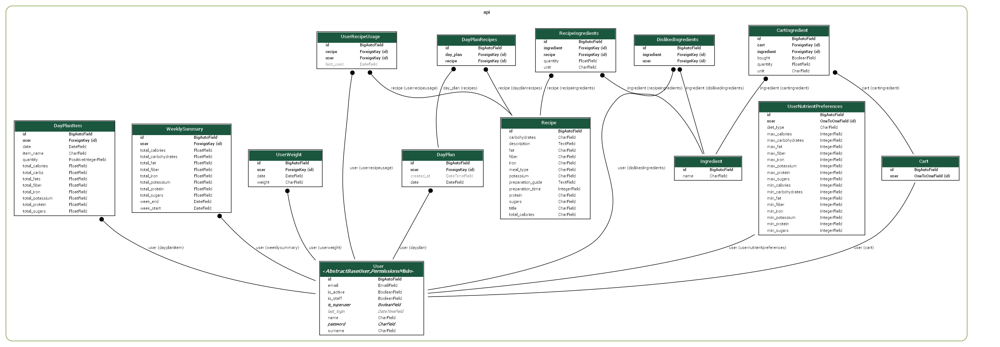

Regenerate with (needs Graphviz installed):

```
cd backend
python manage.py graph_models api --no-inheritance \
  -X LogEntry,Group,Permission,ContentType,Session,AbstractBaseSession,BlacklistedToken,OutstandingToken,AbstractBaseUser,PermissionsMixin \
  -o erd.png
```

## Project layout

```
backend/               Django project (FoodApp/ = settings, api/ = models, views, serializers, planner, tests)
foodApp/               Expo / React Native client
docs/                  screenshots used in this README
docker-compose.yml     PostgreSQL only
```

## Running locally

Requirements: Python 3.12+ (tested on 3.12), Node.js 18+, Docker (for PostgreSQL).

### 1. Configuration

```
copy .env.example .env     # Windows   (cp on macOS/Linux)
```

Fill in `SECRET_KEY` (e.g. `python -c "from django.core.management.utils import get_random_secret_key as k; print(k())"`).
The default `DB_*` values match `docker-compose.yml`. E-mail settings are only
needed for features that send mail.

To open the API from a phone, add your computer's LAN IP to `ALLOWED_HOSTS` in `.env`.
Browser origins allowed to call the API are listed in `CORS_ALLOWED_ORIGINS`.

### 2. Database

```
docker compose up -d db
```

PostgreSQL 16 is exposed on host port **5434**.

### 3. Backend

```
cd backend
python -m venv .venv
.venv\Scripts\activate          # source .venv/bin/activate on macOS/Linux
pip install -r requirements.txt
python manage.py migrate
python manage.py load_recipes   # loads backend/updated_data.csv (5000 sample recipes)
python manage.py runserver
```

The API is served at `http://localhost:8000/api/`. `load_recipes` refuses to run
when recipes already exist (use `--force` to load anyway, which creates duplicates).
To use the Django admin, create a user with `python manage.py createsuperuser`.

### 4. Frontend

```
cd foodApp
copy .env.example .env     # cp on macOS/Linux
npm install
npm start          # then scan the QR code with Expo Go, or press "w" for the browser
```

Set `EXPO_PUBLIC_API_URL` in `foodApp/.env` to the address your app can reach the
backend at, and restart `npm start` after changing it:

| Where the app runs          | `EXPO_PUBLIC_API_URL`              |
|-----------------------------|------------------------------------|
| Browser on the same PC      | `http://localhost:8000/api`        |
| Android emulator            | `http://10.0.2.2:8000/api`         |
| Phone (Expo Go, same Wi-Fi) | `http://<your-LAN-IP>:8000/api`    |

## Tests

```
cd backend
python manage.py test
```

```
Ran 35 tests in ~18s

OK
```

The suite covers JWT auth, nutrient-preference validation, weight tracking, the cart,
day-plan items, the `load_recipes` command and the meal-selection optimiser.

## Known limitations

- `GET /api/recipes/` returns the whole recipe list (no pagination) and recipe search
  filters that list on the client. Fine for 5000 recipes, would not scale much further.
- The planner optimises a single nutrient per diet type. When the chosen limits cannot
  be satisfied the day is left without meals; the app does not explain why.
- Backend tests only; the frontend has no automated tests.
- Sample data is synthetic (see above).
- Development configuration: no HTTPS, no rate limiting, `DEBUG` and the host lists
  come from `.env`.

## Notes

- `DEBUG` is read from `.env` and defaults to `False`; set `DEBUG=True` for local development.
- Secrets are read from `.env`, which is git-ignored.
